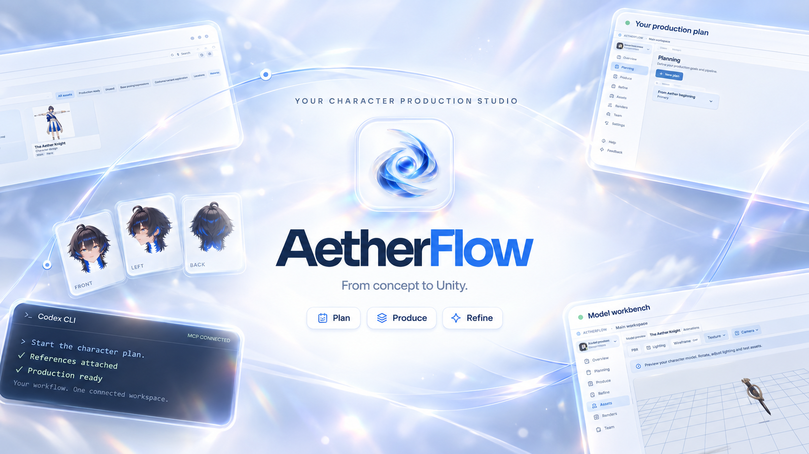

# AetherFlow

[Discord — support, questions & feedback](https://discord.gg/NQPKpmsT7e)

**A desktop workspace for your Unity project, from the first reference to the finished character.**

AetherFlow brings planning, reference art, 3D character production and Unity work reports into one Windows application. It connects these steps with an embedded Codex CLI and an MCP server, so your agent can work with the same plans, files and production state that you see.

[Download the latest release](https://github.com/shiza2xx/AetherFlow/releases/latest)

## What you can do

- **Plan your work.** Organize tasks on a board, track checklist progress and link tasks to projects and characters.
- **Keep references together.** Add artwork to the Gallery and use it to start a character workflow.
- **Follow character production step by step.** Prepare head and body views, AI-generated depth maps, segmented meshes, texture references, assembled models, rigs and final repairs.
- **Inspect and correct your models.** Use the 3D viewer to inspect geometry, textures, rigs and animations. Mark texture defects directly on a model and hand the selected areas to Codex for correction.
- **Continue agent sessions.** Work in the embedded Codex CLI, bind a project or character session and resume it with its existing context.
- **Keep versions and checkpoints.** Track source files, operations, candidates and exports instead of overwriting the only copy of an asset.
- **Record Unity progress.** Collect short work reports with before/after screenshots and matching videos, including multiple camera views.
- **Save private ideas.** Write formatted notes in a Notebook whose content is hidden by default until you reveal it.

The interface supports **English and Russian**, with **NightSky** and **AetherSky** themes.

## How it works

1. **Open or create a workspace.** Each workspace keeps its own project records and managed files.
2. **Add your reference art.** Choose a Gallery concept and start production, or create a plan first and ask Codex to begin the connected workflow.
3. **Generate and review the views.** The agent uses the supplied reference and stage instructions to prepare the requested color views and depth maps. Review the results before continuing.
4. **Generate the 3D sources.** Take the prepared images to your 3D generation service, then import the returned models and segmentation files. Tripo generation and its manual steps happen outside AetherFlow.
5. **Build and refine the character.** Continue through grouping, texture references, texturing, assembly, head fitting, rigging and repairs. Stage guidance explains what to provide, what the agent does and what needs your approval.
6. **Keep the rest of the project moving.** Use the planner, model workbench and Notebook alongside production. When working in Unity, the reporting Skill helps your agent capture the real before/after result and publish it to Unity Activity.

You can request corrections between stages. Production results remain reviewable; an agent-generated candidate is not the same as your approval.

## Codex, Skills and MCP

The MCP server starts with AetherFlow. It lets a connected agent read the current context, navigate the interface, manage plans and tasks, register assets and versions, work with character stages and publish Unity reports.

Character workflow Skills and scripts are supplied with the application and prepared for the relevant task. On the start screen, or in **Settings → Integrations**, use **Install Unity Skill & connect MCP** to install the Unity reporting Skill in your Codex profile and connect the AetherFlow server. Existing configuration and any previous Skill are backed up before changes.

Keep AetherFlow open while using its MCP tools. Restart or reconnect Codex after the initial setup so it can load the new tools and Skill.

## Getting started

- Download the Windows x64 installer from [Releases](https://github.com/shiza2xx/AetherFlow/releases/latest).
- Install and sign in to **Codex CLI** separately to use agent features.
- Have access to an image-generation tool in your agent session and your chosen 3D generation service. Their access requirements and usage costs are separate from AetherFlow.
- **Blender, FFmpeg and ffprobe are included** in the installer; a separate FFmpeg installation is not needed for Unity video recording.

Project records and managed assets are stored locally. Image and 3D generation use the external tools and services you choose.

## What's next

- [ ] **Other CLI integrations:** Claude Code, Antigravity and OpenCode.
- [ ] **Optimization:** smoother interaction, faster model viewing and lower resource use.
- [ ] **Improvements:** clearer workflows, better guidance and everyday quality-of-life fixes.
- [ ] **More features:** additional production tools, MCP commands and Skills.

Have a workflow that AetherFlow could make easier? Share it on [Discord](https://discord.gg/NQPKpmsT7e) or open an [issue](https://github.com/shiza2xx/AetherFlow/issues).

## License

Original AetherFlow application code is licensed under the [MIT License](LICENSE).
Third-party components and materials retain their own license terms; see [third-party notices](app/THIRD_PARTY_NOTICES.md) and the notices supplied with each component.

Some Skills adapt guidance from **Lida**. See the [Skill guidance attribution and retained license](app/docs/licenses/lida/NOTICE.md) for its scope and terms.
